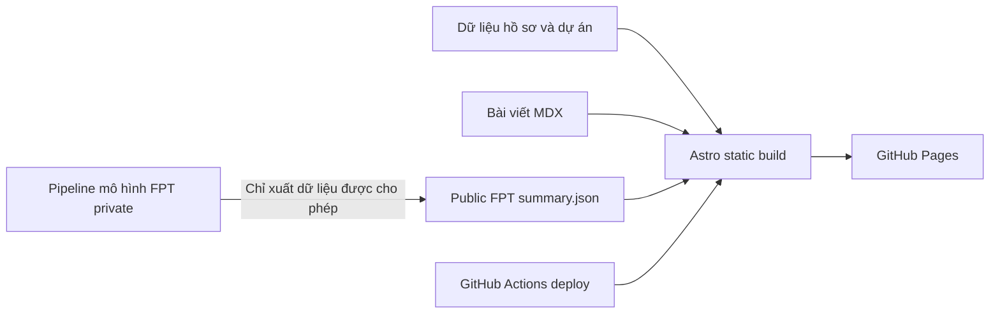

# AI Engineer Portfolio & Technical Blog – Website portfolio và blog kỹ thuật

**Website portfolio tĩnh xây dựng bằng Astro, giới thiệu kiến thức và dự án AI, các bài viết kỹ thuật cùng một giao diện công khai theo dõi kết quả dự đoán xu hướng giá cổ phiếu FPT.**

**Website:** [nguyendao16.github.io](https://nguyendao16.github.io/)  
**Công nghệ:** Astro | TypeScript | Tailwind CSS | MDX | KaTeX | GitHub Actions

Mục tiêu của website là giúp người xem có thể kiểm chứng công việc kỹ thuật: đọc bài viết, xem mô tả dự án và quan sát kết quả dự đoán đã được công bố mà không cần truy cập mã nguồn huấn luyện, dataset hoặc thông tin xác thực trong hệ thống private.

## Điểm nổi bật

- **Portfolio định hướng AI:** Giới thiệu bản thân, kinh nghiệm, dự án, kỹ năng, CV và thông tin liên hệ.
- **Blog kỹ thuật:** Bài viết Markdown/MDX, syntax highlighting và công thức toán bằng LaTeX.
- **Theo dõi dự đoán FPT:** Biểu đồ trình bày 60 phiên giao dịch gần nhất đã được công bố và hướng của dự đoán được phát hành.
- **Kết quả minh bạch:** Phân biệt dự đoán đúng, sai, đang chờ đánh giá và không thể đánh giá.
- **Triển khai tĩnh:** Sử dụng GitHub Actions để deploy lên GitHub Pages; biểu đồ không cần backend inference công khai.
- **Biểu đồ hỗ trợ tương tác và khả năng truy cập:** Hover/touch, điều khiển bằng bàn phím, pan/zoom có giới hạn và tùy chọn giảm hiệu ứng chuyển động.

## Kiến trúc hệ thống



Website public và pipeline dự đoán cổ phiếu private là hai dự án được tách riêng có chủ đích. Repository này chỉ **hiển thị kết quả đã được xuất bản**, không trực tiếp thực thi mô hình dự đoán trong thời gian thực.

## Giao diện theo dõi dự đoán FPT

Thành phần FPT trong [`src/components/FptChart.astro`](src/components/FptChart.astro) đọc dữ liệu từ [`public/fpt/summary.json`](public/fpt/summary.json). Logic kiểm tra dữ liệu, tính tọa độ và xử lý tương tác được đặt trong [`src/utils/`](src/utils/).

### Ranh giới dữ liệu public

Hợp đồng dữ liệu (data contract) của file JSON chỉ cho phép công khai những thông tin cần thiết cho biểu đồ, bao gồm:

- Chính xác **60** bản ghi `{date, close}` được sắp xếp theo ngày.
- Giá đóng cửa mới nhất, mức thay đổi và các mốc thời gian cập nhật/nguồn dữ liệu.
- **Hướng dự đoán**, ngày phát hành, ngày mục tiêu và thời điểm hết hiệu lực (nếu có dự đoán).
- Số lượng dự đoán tổng hợp theo 4 trạng thái: `correct`, `incorrect`, `pending` và `unscorable`.
- Các marker trạng thái theo ngày, giới hạn trong khoảng thời gian đang hiển thị.

Dữ liệu public **không bao gồm** trọng số mô hình, feature huấn luyện, xác suất nội bộ, thông tin xác thực hoặc toàn bộ lịch sử dự đoán private. Workflow private chỉ xuất ra artifact theo danh sách trường được phép; website sẽ kiểm tra hợp đồng dữ liệu trước khi hiển thị.

### Cách diễn giải biểu đồ

Đường liền thể hiện **giá đóng cửa thực tế**. Đoạn nét đứt chỉ biểu thị **hướng dự đoán**, không phải giá mục tiêu hay mức lợi nhuận dự kiến. Các dự đoán đang chờ kết quả vẫn được ghi là `pending` và không tính là đúng hoặc sai cho đến khi pipeline private công bố nhãn kết quả. Website phân biệt rõ dự đoán đã thực sự phát hành với kết quả backtest giả định.

Dự án minh họa cách thiết kế data contract, kiểm soát dữ liệu công khai, trực quan hóa trung thực và tích hợp CI/CD. **Đây không phải hệ thống giao dịch trực tiếp hoặc lời khuyên đầu tư.**

## Cấu trúc trang và nội dung

```text
src/
  components/             # UI tái sử dụng và thành phần biểu đồ FPT
  content/blog/           # Bài viết kỹ thuật dạng MDX
  content/config.ts       # Schema kiểm tra frontmatter bài viết
  data/profile.ts         # Hồ sơ cá nhân và nội dung tương tự CV
  data/projects.ts        # Danh sách dự án portfolio
  data/site.ts            # Nội dung giao diện và SEO
  pages/                  # Các trang Home, About, Projects, Blog, Resume, Contact
  styles/                 # CSS toàn cục
  utils/                  # Tiện ích cho blog và biểu đồ FPT
public/
  fpt/summary.json        # Kết quả FPT được phép công khai
  images/                 # Hình minh họa tĩnh
  resume/resume.pdf       # File CV
.github/workflows/deploy.yml
tests/                    # Kiểm thử Node.js cho website và data contract
```

## Chạy website trên máy cá nhân

Sử dụng Node.js 20, trùng với phiên bản được cấu hình trong workflow triển khai.

```bash
npm ci
npm run dev
```

Chạy các bài kiểm thử, build và xem thử phiên bản production:

```bash
node --test tests/*.test.mjs
npm run build
npm run preview
```

Lệnh `npm run build` thực hiện `astro check` rồi tạo bản build tĩnh. Workflow triển khai còn chạy riêng `tests/fpt-chart.test.mjs` trước khi xuất bản.

## Đăng bài viết kỹ thuật

Thêm file `.mdx` mới vào `src/content/blog/` với frontmatter ví dụ:

```mdx
---
title: "Tìm hiểu lan truyền gradient trong mạng RNN"
description: "Giải thích toán học từng bước kèm ví dụ minh họa."
date: 2026-10-23
tags: ["deep-learning", "rnn", "mathematics"]
---

Viết nội dung bài viết tại đây. Có thể thêm code và công thức:

$$
\frac{\partial L}{\partial h_t}
$$
```

Schema cũng hỗ trợ các trường tùy chọn như ngày cập nhật, ảnh bìa, trạng thái bản nháp và thiết lập SEO. Tham khảo [`src/content/config.ts`](src/content/config.ts) và [`CONTENT_GUIDE.md`](CONTENT_GUIDE.md).

## Chỉnh sửa nội dung portfolio

| Nội dung | File cần sửa |
| --- | --- |
| Tên, giới thiệu, kinh nghiệm, chứng chỉ và kỹ năng | [`src/data/profile.ts`](src/data/profile.ts) |
| Mô tả và đường dẫn các dự án | [`src/data/projects.ts`](src/data/projects.ts) |
| Nội dung giao diện và SEO | [`src/data/site.ts`](src/data/site.ts) |
| Thanh điều hướng | [`src/data/navigation.ts`](src/data/navigation.ts) |
| Bài viết blog | `src/content/blog/*.mdx` |
| File CV tải về | `public/resume/resume.pdf` |

Những chỉ số được đưa lên portfolio cần có nguồn kiểm chứng từ báo cáo hoặc thực nghiệm có thể tái lập. **Không sử dụng các giá trị ví dụ làm kết quả đo thực tế.**

## Triển khai lên GitHub Pages

Workflow tại [`.github/workflows/deploy.yml`](.github/workflows/deploy.yml) chạy khi có cập nhật trên nhánh `main` hoặc được kích hoạt thủ công. Workflow cài đặt dependency, kiểm tra hợp đồng dữ liệu FPT, build website, upload bản build tĩnh và deploy lên GitHub Pages.

1. Bật **GitHub Pages**, chọn nguồn deploy là **GitHub Actions**.
2. Kiểm tra và đặt đúng địa chỉ `site` trong [`astro.config.mjs`](astro.config.mjs).
3. Push lên `main`, sau đó kiểm tra kết quả ở tab Actions.

Pipeline xuất bản FPT sử dụng một **deploy key chuyên dụng có quyền ghi** và lưu khóa bí mật ở phía repository **private**; không lưu personal access token trong repo website public. Tuyệt đối không commit private key hoặc credentials huấn luyện.

## Kiểm thử và độ tin cậy

Các bài test trong [`tests/`](tests/) kiểm tra một phần mô hình nội dung, cấu trúc website và hành vi của biểu đồ FPT. Đặc biệt, test biểu đồ xác minh danh sách trường JSON được phép, cửa sổ 60 phiên, trạng thái dự đoán đang chờ/hết hạn, các marker kết quả và giới hạn pan/zoom.

Đường biểu diễn tĩnh vẫn xuất hiện khi không có JavaScript phía trình duyệt; các tương tác nâng cao cần JavaScript.

## Tác giả

Website được xây dựng và duy trì bởi [Đào Khôi Nguyên](https://github.com/nguyendao16). Repository hiện chưa khai báo giấy phép mã nguồn mở ở cấp thư mục gốc.
